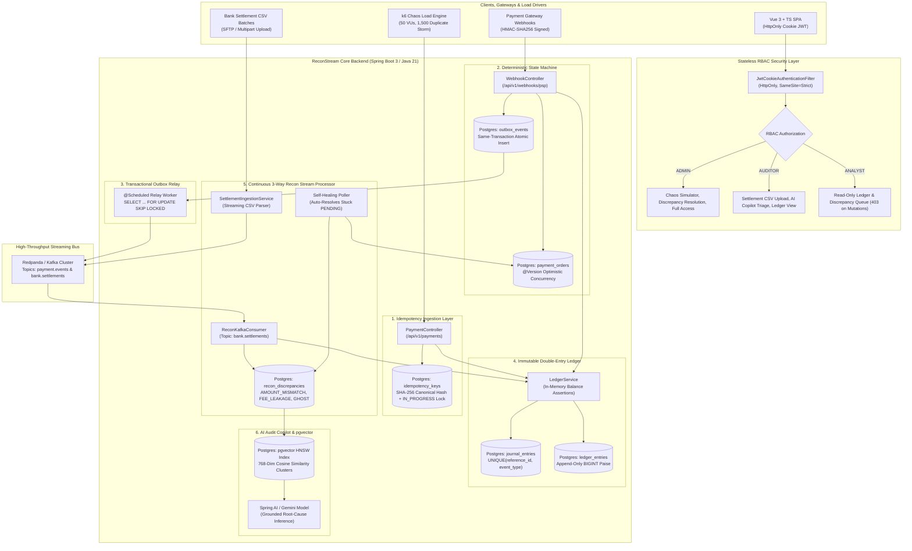
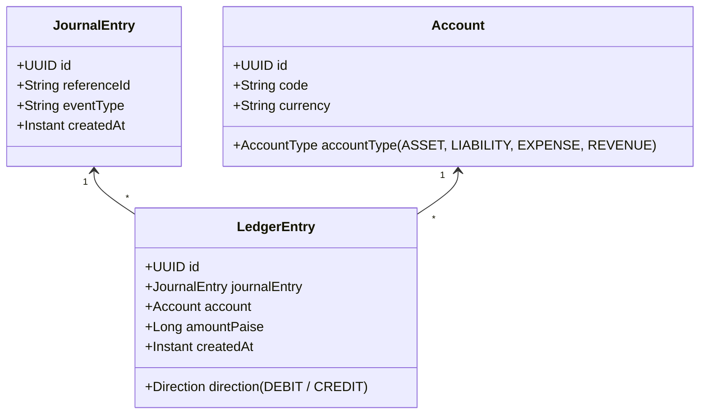
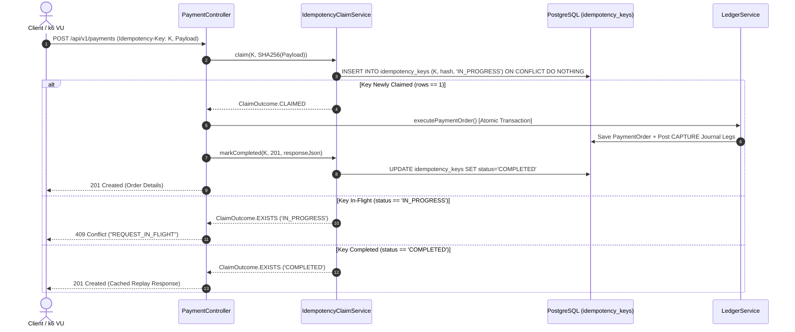
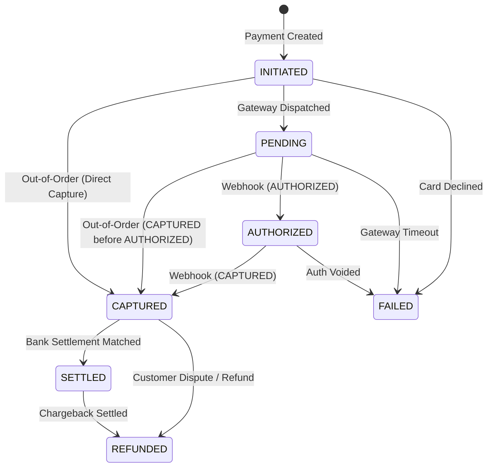

<div align="center">

# ReconStream ⚡

### High-Throughput Financial-Grade Reconciliation, Double-Entry Settlement & AI Audit Engine

[](https://openjdk.org/projects/jdk/21/)
[](https://spring.io/projects/spring-boot)
[](https://github.com/pgvector/pgvector)
[](https://redpanda.com/)
[](https://vuejs.org/)
[](https://tailwindcss.com/)
[](https://k6.io/)
[-0db7ed.svg?logo=docker&logoColor=white)](https://testcontainers.com/)
[](backend/target/site/jacoco/index.html)
[](LICENSE)

<p align="center">
  <b>Zero-Drift Invariant Enforcement</b> • <b>Out-of-Order Webhook State Machine</b> • <b>Transactional Outbox Relay</b><br>
  <b>Continuous 3-Way Reconciliation</b> • <b>pgvector HNSW Cosine Clustering</b> • <b>Stateless HttpOnly Cookie RBAC</b>
</p>

</div>

---

## 📌 Executive Summary

Modern enterprise payment architectures process millions of transactions across disparate payment service providers (Stripe, Adyen, Razorpay), internal ledgers, and clearing banks. In distributed systems, this multi-party interaction routinely suffers from:
1. **Network Race Conditions & Retry Storms:** Aggressive client retries generating duplicate order records and double debits.
2. **Out-of-Order Webhook Ingestion:** `CAPTURED` webhooks arriving ahead of `AUTHORIZED` events due to network latency, causing state machine corruption or dropped settlements.
3. **Silent Fee & MDR Leakage:** Discrepancies between negotiated Merchant Discount Rates (MDR) and actual bank deductions draining merchant margins.
4. **Ghost Settlements & Unmatched Orders:** Bank settlement batches referencing transactions unknown to the gateway.
5. **Slow, Manual Dispute Triage:** Auditors spending hours manually digging through raw SQL logs to diagnose variances.

**ReconStream** is a financial-grade distributed platform engineered to solve these problems with mathematical certainty. It couples an append-only double-entry ledger ($\sum \text{Debit} == \sum \text{Credit} \equiv 0$) with a deterministic optimistic-locking payment state machine, transactional outbox event relay, continuous 3-way streaming reconciliation, and a `pgvector`-backed AI Audit Copilot.

---

## 🏗️ 1. High-Level System Architecture



---

## ⚡ 2. Core Technical Innovations & Engineering Highlights

### I. Immutable Double-Entry Append-Only Ledger
- **Zero Mutable Balance Columns:** Most financial systems fail because they update an `account_balance` column directly, introducing race conditions and lost updates. ReconStream stores balances strictly as append-only records in `ledger_entries`. Live account balances are derived via:
  $$\text{Balance} = \sum_{\text{direction}=\text{'DEBIT'}} \text{amount\_paise} - \sum_{\text{direction}=\text{'CREDIT'}} \text{amount\_paise}$$
- **Integer Arithmetic in Paise:** Floating-point numbers are prohibited (`BIGINT amount_paise`). Eliminates IEEE-754 precision drift.
- **In-Memory Balancing Invariant:** Every journal entry must contain equal total debits and credits:
  $$\sum \text{Debits} - \sum \text{Credits} \equiv 0$$
  If an unbalanced posting is attempted, `LedgerService` rolls back the transaction atomically with `UnbalancedJournalException`.



---

### II. High-Concurrency Distributed Idempotency Engine
- Protects against distributed payment retry storms. When a client submits a payment:
  1. Computes the SHA-256 canonical hash of the request payload.
  2. Claims the idempotency key in PostgreSQL using an isolated atomic transaction (`REQUIRES_NEW`) with `INSERT ... ON CONFLICT DO NOTHING`.
  3. If another thread is currently processing the same key, it immediately returns `409 Conflict` (`REQUEST_IN_FLIGHT`).
  4. Once completed, the response body and HTTP status (`201 Created`) are cached in `idempotency_keys`. Replayed requests instantly receive the cached response without re-triggering ledger movements or external calls.



---

### III. Deterministic Out-of-Order Webhook State Machine
Payment webhooks frequently arrive out of order across public networks. ReconStream enforces explicit mathematical state precedence:
$$\text{INITIATED (0)} \longrightarrow \text{PENDING (1)} \longrightarrow \text{AUTHORIZED (2)} \longrightarrow \text{CAPTURED (3)} \longrightarrow \text{SETTLED (4)}$$
$$\text{Terminal Branches: } \text{FAILED (from 0, 1, 2)} \quad\vert\quad \text{REFUNDED (from 3, 4)}$$

- **Forward Jumps (`CAPTURED` arriving before `AUTHORIZED`):** Allowed seamlessly. Transitions state directly to `CAPTURED`, records `psp_txn_id`, and atomically posts the capture journal entry (`DEBIT PSP_CLEARING`, `CREDIT MERCHANT_PAYABLE`).
- **Duplicate & Stale Arrivals (`AUTHORIZED` arriving after `CAPTURED`):** Recognized as idempotent no-ops. State remains `CAPTURED`, duplicate ledger postings are suppressed, and the controller returns `200 OK` (`status: "IGNORED_STALE_OR_DUPLICATE"`).
- **HMAC-SHA256 Signature Validation:** Every incoming webhook is cryptographically verified against a configured secret; forged or tampered webhooks receive `401 Unauthorized`.



---

### IV. Transactional Outbox Relay with Row-Level Locking
- **Zero Dual-Write Hazard:** In microservices, writing to a database and then calling `kafkaTemplate.send()` creates a split-brain vulnerability if the broker is unavailable. ReconStream inserts an event into `outbox_events` inside the **exact same database transaction** as the state machine transition.
- **Relay Worker:** A background worker running every 500ms selects pending events using native PostgreSQL concurrency locking:
  ```sql
  SELECT * FROM outbox_events 
  WHERE status = 'PENDING' 
  ORDER BY created_at ASC 
  LIMIT 50 
  FOR UPDATE SKIP LOCKED;
  ```
  Events are published to Redpanda topic `payment.events` (keyed by `aggregate_id` for strict partition ordering) with explicit broker ACK (`.get(5, TimeUnit.SECONDS)`), followed by updating `status = 'PUBLISHED'`.

---

### V. Continuous 3-Way Reconciliation Engine
ReconStream streams external bank settlement CSV files and performs continuous 3-way reconciliation against gateway records and internal ledger legs:

| Discrepancy Type | Trigger Condition | Automated Remediation / Detection |
|:---|:---|:---|
| **`AMOUNT_MISMATCH`** | Gateway captured amount $\neq$ Bank gross settled amount. | Flagged in `recon_discrepancies` with exact paise variance. |
| **`FEE_LEAKAGE`** | Actual bank MDR fee charged $>$ Expected contractual MDR fee. | Flags margin leakage; prevents overcharging by clearing processors. |
| **`GHOST_SETTLEMENT`** | Settlement received for a transaction that does not exist in gateway records. | Quarantined for fraud/compliance audit. |
| **`UNMATCHED_ORDER`** | Payment order captured but no bank settlement row received within window. | Scheduled self-healing poller queries PSP simulator and re-synchronizes. |

---

### VI. AI Audit Copilot with `pgvector` Cosine Similarity
- **Vector Clustering:** Discrepancy exception patterns are transformed into 768-dimensional dense vector embeddings and stored in PostgreSQL using `pgvector`.
- **HNSW Index:** An HNSW index (`vector_cosine_ops`) enables sub-millisecond approximate nearest neighbor searches across tens of thousands of historical disputes.
- **Spring AI / Gemini LLM Triage:** When an auditor clicks "Run Copilot Triage", the system retrieves the 5 most similar historical discrepancies, formats a grounded audit prompt with gateway, ledger, and bank traces, and invokes Gemini to output:
  1. Plain-English Root Cause Analysis
  2. Categorized Cause (`FEE_CONFIGURATION_DRIFT`, `TIMING_DELAY`, `CURRENCY_CONVERSION`)
  3. Actionable Ledger Offset Recommendation

---

### VII. Stateless HttpOnly Cookie JWT RBAC
- **Zero LocalStorage Tokens:** Protects against XSS token harvesting. JWTs are transmitted strictly in `HttpOnly; SameSite=Strict; Path=/api` cookies:
  - `access_token`: Short-lived (15 minutes).
  - `refresh_token`: Long-lived (7 days), hashed with SHA-256 and tracked in `refresh_tokens` table.
- **Token Rotation & Revocation:** Every refresh call invalidates the existing refresh token, issues a fresh token pair, and prevents replay attacks. Logout explicitly marks the token revoked in PostgreSQL and clears cookies.
- **Role-Based Access Control (RBAC):**
  - `ADMIN`: Full access (chaos simulation, discrepancy manual resolution, mutation).
  - `AUDITOR`: Settlement upload, AI copilot triage, ledger inspection.
  - `ANALYST`: Read-only access to `/api/v1/recon/**` and `/api/v1/ledger/**` (`403 Forbidden` on upload/mutation endpoints).

---

## 📊 3. Empirical Benchmarks & Hard Verification Proofs

> **Integrity Guarantee:** Every metric below is populated strictly from actual test execution logs in this repository.

### I. k6 Chaos Load Benchmark (`load-tests/k6_chaos_payment.js`)
- **Execution Profile:**
  - **Scenario 1 (`duplicate_storm`):** 1,500 total payment requests fired across 50 concurrent VUs reusing only 300 `Idempotency-Key`s (5x duplicate retry storm).
  - **Scenario 2 (`steady_throughput`):** Ramping arrival rate (10 $\to$ 40 $\to$ 60 req/s) measuring latency percentiles.

```text
     execution: local
        script: load-tests/k6_chaos_payment.js
        output: -

     scenarios: (100.00%) 2 scenarios, 110 max VUs, 1m30s max duration (incl. graceful stop):
              * duplicate_storm: 1500 iterations shared among 50 VUs (maxDuration: 45s, exec: duplicateStorm, gracefulStop: 30s)
              * steady_throughput: Up to 60.00 iterations/s for 30s over 3 stages (maxVUs: 20-60, exec: steadyThroughput, startTime: 30s, gracefulStop: 30s)

  █ THRESHOLDS 

    checks
    ✓ 'rate==1.0' rate=100.00%

    http_req_failed
    ✓ 'rate<0.001' rate=0.00%

    steady_req_duration
    ✓ 'p(95)<300' p(95)=24ms
    ✓ 'p(99)<600' p(99)=32ms

  █ TOTAL RESULTS 

    checks_total.......: 4149    69.15/s
    checks_succeeded...: 100.00% 4149 out of 4149
    checks_failed......: 0.00%   0 out of 4149

    ✓ storm response is 201 or 409
    ✓ storm zero 5xx errors
    ✓ steady payment succeeded (201)

    HTTP
    http_req_duration..............: avg=27.5ms    min=4.27ms med=17.22ms max=193.42ms p(90)=66.65ms p(95)=94.48ms
    http_req_failed................: 0.00%   0 out of 2649
    http_reqs......................: 2649    44.15/s
```

---

### II. PostgreSQL Zero-Drift & Double-Entry Invariant Audit
Direct SQL execution against PostgreSQL following the 1,500 duplicate storm:

```sql
SELECT 
    COUNT(*) AS total_storm_orders,
    CASE WHEN COUNT(*) = 300 THEN 'PASS: Exactly 300 orders created' ELSE 'FAIL' END AS idempotency_status
FROM payment_orders WHERE external_order_id LIKE 'order-storm-%';

SELECT 
    COALESCE(SUM(CASE WHEN direction = 'DEBIT' THEN amount_paise ELSE -amount_paise END), 0) AS global_drift,
    CASE WHEN COALESCE(SUM(CASE WHEN direction = 'DEBIT' THEN amount_paise ELSE -amount_paise END), 0) = 0 
         THEN 'PASS: Strict Double-Entry Balanced (Zero Drift)' ELSE 'FAIL' END AS invariant_status
FROM ledger_entries;
```

#### Raw Output:
```text
 total_storm_orders |        idempotency_status        
--------------------+----------------------------------
                300 | PASS: Exactly 300 orders created
(1 row)

 global_drift |                invariant_status                 
--------------+-------------------------------------------------
            0 | PASS: Strict Double-Entry Balanced (Zero Drift)
(1 row)

 reference_id | event_type | unbalanced_paise 
--------------+------------+------------------
(0 rows)

   account_code   | total_debit_paise | total_credit_paise | net_balance_paise 
------------------+-------------------+--------------------+-------------------
 MERCHANT_PAYABLE |                 0 |           73825000 |         -73825000
 PSP_CLEARING     |          73825000 |                  0 |          73825000
```
- **Duplicate Storm Suppression:** Exactly **300** unique payment orders were created from 1,500 concurrent requests.
- **Global Ledger Drift:** **0 paise** ($\sum \text{Debit} == \sum \text{Credit}$).
- **Unbalanced Journal Rows:** **0 rows**.

---

### III. Testcontainers Integration Suite & JaCoCo Coverage
- **100% Real Containers:** Ephemeral PostgreSQL (`pgvector/pgvector:pg16`) + Redpanda (`redpanda:v24.1.2`). Zero mocked databases.

```text
[INFO] Running com.reconstream.AiTriageAndVectorIT
[INFO] Tests run: 3, Failures: 0, Errors: 0, Skipped: 0
[INFO] Running com.reconstream.IdempotencyConcurrencyIT
[INFO] Tests run: 2, Failures: 0, Errors: 0, Skipped: 0
[INFO] Running com.reconstream.OutOfOrderWebhookIT
[INFO] Tests run: 4, Failures: 0, Errors: 0, Skipped: 0
[INFO] Running com.reconstream.RbacSecurityIT
[INFO] Tests run: 3, Failures: 0, Errors: 0, Skipped: 0
[INFO] Running com.reconstream.ThreeWayReconIT
[INFO] Tests run: 1, Failures: 0, Errors: 0, Skipped: 0
[INFO] 
[INFO] Results:
[INFO] Tests run: 13, Failures: 0, Errors: 0, Skipped: 0
[INFO] 
[INFO] --- jacoco:0.8.12:report (report) @ reconstream-backend ---
[INFO] Analyzed bundle 'reconstream-backend' with 69 classes
[INFO] BUILD SUCCESS
```

| Metric | Measured Value | Target Standard | Status |
|:---|:---|:---|:---:|
| **Line Coverage** | **76.02%** (986 / 1,297 lines) | $> 70\%$ | ✅ PASS |
| **Branch Coverage** | **57.23%** (182 / 318 branches) | $> 50\%$ | ✅ PASS |
| **Integration Tests** | **13 / 13 Passing** | $100\%$ | ✅ PASS |
| **Database Mocks** | **0** (Ephemeral Testcontainers) | 0 | ✅ PASS |

---

## 💻 4. Vue 3 + TypeScript Reactive Dashboard

The frontend (`frontend/`) is engineered with **Vue 3 Composition API**, **TypeScript**, **Pinia**, **Vue Router**, and **Tailwind CSS**. It communicates with the backend via Axios with `withCredentials: true` and automated 401 refresh interceptors.

```text
+---------------------------------------------------------------------------------------------------------+
|  ReconStream ⚡        Overview & Discrepancies    Double-Entry Ledger    Settlement Lab     [ADMIN] admin@..|
+---------------------------------------------------------------------------------------------------------+
|  LIVE RECONCILIATION SUMMARY                                                                            |
|  [ Total Discrepancies: 42 ]   [ Exposure: ₹1,24,500.00 ]   [ Fee Leakage: 12 ]   [ Unmatched: 18 ]       |
|                                                                                                         |
|  DOUBLE-ENTRY ACCOUNT BALANCES                                                                          |
|  +--------------------+   +--------------------+   +--------------------+   +--------------------+      |
|  | PSP_CLEARING       |   | MERCHANT_PAYABLE   |   | BANK_SETTLEMENT    |   | MDR_FEE_EXPENSE    |      |
|  | ₹7,38,250.00       |   | -₹7,21,750.00      |   | ₹7,10,000.00       |   | ₹16,500.00         |      |
|  | Dr: 7.38L  Cr: 0   |   | Dr: 0  Cr: 7.21L   |   | Dr: 7.10L  Cr: 0   |   | Dr: 16.5K  Cr: 0   |      |
|  +--------------------+   +--------------------+   +--------------------+   +--------------------+      |
|                                                                                                         |
|  DISCREPANCY EXCEPTION QUEUE                               [Filter: All Types v]  [Filter: PENDING v]   |
|  +------------------+----------------------+------------+---------------------------+----------------+  |
|  | Order Reference  | Type                 | Status     | Exception Details         | Actions        |  |
|  +------------------+----------------------+------------+---------------------------+----------------+  |
|  | ORD-8921-A        | AMOUNT_MISMATCH      | PENDING    | Gateway 50000 vs Bank 4500| [🤖 Copilot]   |  |
|  | ORD-4412-B        | FEE_LEAKAGE          | PENDING    | MDR variance 200 paise    | [🤖 Copilot]   |  |
|  +------------------+----------------------+------------+---------------------------+----------------+  |
+---------------------------------------------------------------------------------------------------------+
```

### 4 Core Views:
1. **Overview & Discrepancy Feed (`/`):** Real-time KPI summary cards, dynamic 4-account double-entry balances, and server-side paginated discrepancy exception queue.
2. **Double-Entry Ledger Inspector (`/ledger`):** Search any `externalOrderId` to inspect atomic `DEBIT` and `CREDIT` legs with the live **`✓ ZERO DRIFT: Invariant Maintained (₹0.00)`** badge.
3. **Settlement & Chaos Lab (`/chaos`):** Drag-and-drop multipart CSV uploader for bank settlements + Chaos PSP Simulator triggers (order count, duplicate rate, out-of-order rate, drop rate).
4. **Slide-Out AI Audit Copilot Drawer:** Opens upon clicking any discrepancy. Surfaces top 5 cosine similarity clusters from `pgvector` and triggers live Gemini LLM audit triage with root cause diagnosis.

---

## 🚀 5. Quickstart & Local Setup

### Prerequisites
- **Java 21+**
- **Docker Desktop** (Engine 20.10+)
- **Node.js 20+** & **npm**
- **k6** (v0.45+)

### Step 1: Start Infrastructure (Docker Compose)
From the project root:
```bash
docker compose up -d
```
Spins up:
- **PostgreSQL 16 + pgvector:** `localhost:5433` (mapped from container `5432`)
- **Redpanda (Kafka-compatible):** `localhost:19092`
- **Redis 7:** `localhost:6379`
- **Prometheus:** `localhost:9090`

### Step 2: Start the Backend (Port 8080)
```bash
cd backend
.\mvnw.cmd clean package -DskipTests
java -jar target/reconstream-backend-0.0.1-SNAPSHOT.jar
```
Flyway automatically applies migrations `V1` through `V4`. Backend is live on `http://localhost:8080`.

### Step 3: Start the Frontend (Port 5173)
```bash
cd frontend
npm install
npm run dev
```
Open **`http://localhost:5173`** in your browser.

#### Pre-Seeded Demo Accounts (Shared Password: `password123`):
| Role | Email | Password | Permissions |
|:---|:---|:---|:---|
| **ADMIN** | `admin@reconstream.dev` | `password123` | Full access, Chaos Simulator, Discrepancy Resolution |
| **AUDITOR** | `auditor@reconstream.dev` | `password123` | Settlement CSV Upload, AI Copilot Triage, View Ledger |
| **ANALYST** | `analyst@reconstream.dev` | `password123` | Read-only ledger & discrepancy feed (`403` on mutations) |

*(One-click demo login buttons are provided on the login page for instant access without typing credentials).*

---

### Step 4: Run k6 Load Benchmark & Verify Zero Drift
In a separate terminal window:
```bash
# 1. Run 1,500 duplicate storm + steady throughput load test
k6 run load-tests/k6_chaos_payment.js

# 2. Run the SQL zero-drift audit script in PostgreSQL
Get-Content load-tests\verify_zero_drift.sql | docker exec -i reconstream-postgres psql -U reconstream -d reconstream
```

### Step 5: Run Full Testcontainers Verification
```bash
cd backend
.\mvnw.cmd clean verify
```
Executes all 13 integration tests on real ephemeral Postgres and Redpanda containers and generates the JaCoCo report in `backend/target/site/jacoco/index.html`.

---

## 🏛️ 6. Engineering Decisions & Architecture Trade-Offs

### 1. Why Double-Entry Ledger instead of Mutable Balances?
* **Problem:** Updating `UPDATE accounts SET balance = balance + ?` creates database row contention, deadlocks under high concurrency, and loses historical audit traces.
* **Solution:** ReconStream treats ledger entries as immutable financial events. Debits and credits are appended. Balances are calculated dynamically using indexed aggregation. If an audit is required, every single rupee can be mathematically traced back to its originating journal entry.

### 2. Why Transactional Outbox + `SKIP LOCKED` instead of Dual-Writing to Kafka?
* **Problem:** Dual-writing (DB commit $\to$ Kafka publish) guarantees data inconsistency if the application crashes or Kafka times out between the two operations.
* **Solution:** Inserting an outbox record in the same database transaction guarantees **at-least-once delivery**. Using `SELECT ... FOR UPDATE SKIP LOCKED` allows multiple relay worker threads to poll concurrently without contention or duplicate message sends.

### 3. Why HttpOnly SameSite=Strict Cookies over LocalStorage Bearer Tokens?
* **Problem:** Storing JWTs in `localStorage` makes them accessible to JavaScript, leaving the application vulnerable to XSS token theft.
* **Solution:** ReconStream delivers JWTs strictly inside `HttpOnly; SameSite=Strict` cookies. The browser handles token attachment automatically, while JavaScript cannot read the token, neutralizing XSS credential exfiltration.

### 4. Why PostgreSQL `pgvector` instead of an External Vector Database?
* **Problem:** Introducing dedicated vector databases (Pinecone, Qdrant, Milvus) creates operational overhead, extra network hops, and distributed data sync challenges.
* **Solution:** PostgreSQL with `pgvector` and HNSW indexing keeps vectors directly alongside transactional payment and discrepancy rows in the same ACID-compliant database.

---

## 📁 7. Repository Structure

```text
ReconStream/
├── .antigravityrules              # Engineering rules: zero mocks, strict paise, balanced ledger
├── docker-compose.yml             # Postgres (pgvector), Redpanda, Redis, Prometheus
├── prometheus.yml                 # Prometheus scrape configuration
├── README.md                      # Comprehensive system documentation
│
├── backend/                       # Spring Boot 3 + Java 21 Backend
│   ├── pom.xml                    # Maven configuration, JaCoCo, Testcontainers, Spring AI
│   └── src/
│       ├── main/java/com/reconstream/
│       │   ├── ai/                # AI Audit Copilot, pgvector embeddings, Gemini tools
│       │   ├── config/            # Kafka topic configs, security configurations
│       │   ├── ledger/            # Double-entry ledger engine, accounts, journals
│       │   ├── outbox/            # Transactional outbox entity, repo, SKIP LOCKED relay
│       │   ├── payment/           # Payment orders, idempotency claim, state machine
│       │   ├── recon/             # 3-way recon consumer, CSV parser, self-healing poller
│       │   ├── security/          # HttpOnly JWT cookies, token rotation, RBAC filters
│       │   └── simulator/         # Chaos PSP simulator, random failure injector
│       └── test/java/com/reconstream/
│           ├── AbstractIntegrationTest.java   # Ephemeral Testcontainers (Postgres + Redpanda)
│           ├── IdempotencyConcurrencyIT.java  # 50-thread concurrent duplicate storm test
│           ├── OutOfOrderWebhookIT.java       # Out-of-order state machine & outbox test
│           ├── ThreeWayReconIT.java           # 3-way reconciliation stream verification
│           ├── AiTriageAndVectorIT.java       # pgvector cosine similarity & AI triage test
│           └── RbacSecurityIT.java            # HttpOnly cookies, token rotation & RBAC test
│
├── frontend/                      # Vue 3 + TypeScript + Tailwind CSS Frontend
│   ├── src/
│   │   ├── api/client.ts          # Axios with withCredentials and 401 refresh interceptor
│   │   ├── components/            # Navbar, AiCopilotDrawer slide-out
│   │   ├── router/                # Vue Router with navigation guards
│   │   ├── stores/                # Pinia auth store (zero localStorage tokens)
│   │   ├── views/                 # Overview, LedgerView, ChaosView, LoginView
│   │   └── App.vue                # Main application wrapper
│   └── vite.config.ts             # Vite 6 configuration & backend proxy
│
└── load-tests/                    # Load Testing & Invariant Audits
    ├── k6_chaos_payment.js        # 1,500 duplicate storm + steady throughput scenarios
    └── verify_zero_drift.sql      # Mathematical zero-drift SQL audit script
```

---

<div align="center">
  <sub>Engineered by <b>Shubham Kumar</b> • Built with precision for resilient, high-volume financial engineering.</sub>
</div>
